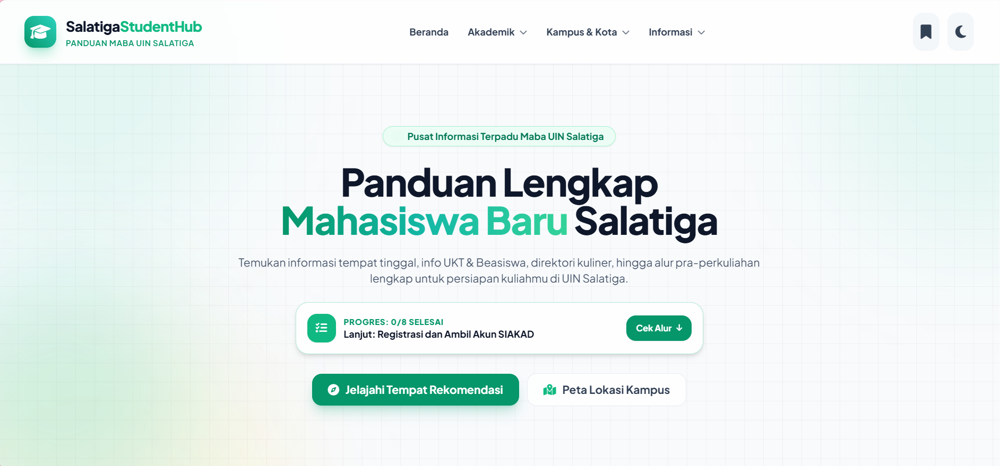
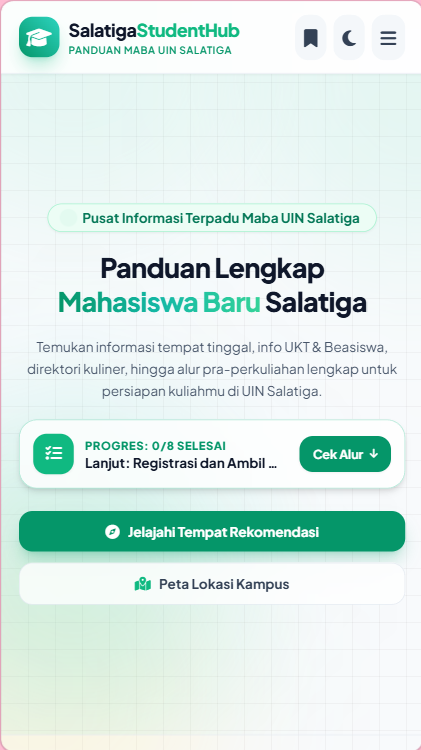
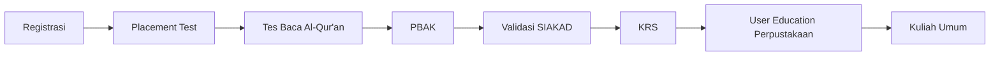

<div align="center">


### Semua informasi penting maba, dalam satu halaman.

**📌 Apa yang harus dilakukan &nbsp;·&nbsp; 🧭 Ke mana harus pergi &nbsp;·&nbsp; 📞 Siapa yang bisa dihubungi**

<br>


<br>

[🌐 **Lihat Demo**](https://salatiga-student-hub.fatimaazzahra10028.workers.dev/) &nbsp;•&nbsp; [💻 **Repository**](https://github.com/fatimaazzahra10028-arch/salatiga-student-hub) &nbsp;•&nbsp; [🏛️ **Situs Resmi UIN Salatiga**](https://uinsalatiga.ac.id/)

</div>

> ⚠️ **Bukan situs resmi UIN Salatiga.** Untuk informasi final, selalu rujuk [uinsalatiga.ac.id](https://uinsalatiga.ac.id/).

---

## 📑 Daftar Isi

- [Identitas Peserta](#-identitas-peserta)
- [Deskripsi Singkat](#-deskripsi-singkat)
- [Kesesuaian dengan Subtema Information](#-kesesuaian-dengan-subtema-information)
- [Fitur Utama](#-fitur-utama)
- [Pemenuhan Ketentuan Lomba](#-pemenuhan-ketentuan-lomba)
- [Teknologi yang Digunakan](#-teknologi-yang-digunakan)
- [Struktur Folder](#-struktur-folder)
- [Cara Menjalankan Website](#-cara-menjalankan-website)
- [Sumber Data dan Catatan Penting](#-sumber-data-dan-catatan-penting)
- [Konfigurasi Form Kontak](#-konfigurasi-form-kontak)
- [Kredit dan Lisensi](#-kredit-dan-lisensi)

---

## 👩 Identitas Peserta

| | |
|---|---|
| **Nama peserta/tim** | **Fatima Azzahra** |
| **Nama website** | **Salatiga Student Hub** (Edition UIN Salatiga) |
| **Kompetisi** | INTECHFEST 2026, Web Development Competition |
| **Subtema** | Information |
| **Penyelenggara** | HMPS Teknologi Informasi × HMPS Perpustakaan Sains Informasi, UIN Salatiga |

## 📸 Tampilan

| Desktop | Mobile |
|---|---|
|  |  |


## 🌐 Deskripsi Singkat

**Salatiga Student Hub** adalah portal informasi satu halaman untuk calon mahasiswa baru (maba) UIN Salatiga. Informasi untuk maba biasanya tersebar di banyak pengumuman dan kanal. Website ini mengumpulkannya di satu tempat yang rapi, mudah dicari, dan nyaman dibuka dari HP.

- 📄 **Informasi akademik** disusun dari pengumuman resmi kampus (Pengumuman Rektor `B-1047/Un.29/R/PP.00.1/07/2026`).
- 🏘️ **Informasi tempat** di sekitar kampus (kost, cafe, percetakan) membantu maba beradaptasi dengan kehidupan di Salatiga.

## 🎯 Kesesuaian dengan Subtema Information

Berdasarkan pembaruan panitia (14 Oktober 2026), subtema lomba adalah **Information**, menggantikan *Digital Branding for Local Business*. Cakupan tema diperluas dan tidak lagi terbatas pada bisnis, dengan fungsi utama **menyajikan informasi**.

| Prinsip informasi | Penerapan di website |
|---|---|
| 🧲 **Terpusat** | Semua topik maba ada dalam satu halaman dengan navigasi per bagian |
| 🔎 **Dapat ditelusuri** | Pencarian real-time (fakultas/prodi dan tempat), filter kategori, urutan terdekat |
| ✅ **Dapat ditindaklanjuti** | Alur 8 langkah dengan pelacak progres, tautan langsung ke portal resmi, kontak WhatsApp |
| 🛡️ **Dapat dipercaya** | Setiap bagian mencantumkan sumber dan tanggal pengecekan, serta peringatan jika data belum diverifikasi |
| ♿ **Dapat diakses** | Responsif, mode terang/gelap, label ARIA, menghormati `prefers-reduced-motion` |

## 🚀 Fitur Utama

### 📋 Alur Mahasiswa Baru
8 langkah pra-perkuliahan yang bisa dicentang, dengan progress bar dan filter **Semua / Belum Selesai / Selesai**. Progres tersimpan di browser dan ringkasannya tampil di Hero.



### 🏛️ Fakultas dan Program Studi
- **6 fakultas** dan **28 prodi S1**
- Pencarian real-time berdasarkan nama prodi atau fakultas
- Klik kartu untuk melihat lokasi kampus, tautan peta, dan situs resmi fakultas

### 🗺️ Peta Kampus
Peta interaktif **3 kampus UIN Salatiga** (Kampus 1, Kampus 2, Kampus 3 Terpadu) dengan pemilih kampus dan alamat lengkap.

### 💰 UKT dan Beasiswa
Penjelasan sistem UKT, langkah penting mahasiswa, persiapan berkas KIP Kuliah/beasiswa, serta tautan ke portal Registrasi dan pengumuman resmi.

### 🏘️ Hidup di Salatiga
Direktori **14 tempat** di sekitar kampus (5 kost, 5 cafe, 4 print & jilid):
- Pencarian real-time nama tempat atau area
- Filter kategori: Semua · Kost · Cafe · Print & Jilid
- Urutan **terdekat dari kampus**
- Modal detail layar penuh (deskripsi, fasilitas, kontak, peta) dengan keterangan **sumber foto**
- **Simpanan Saya**: simpan tempat favorit, tersimpan di browser

### ❓ FAQ dan Kontak
- 6 pertanyaan umum dalam akordeon (login SIAKAD, data berbeda dengan KTP, placement test, nomor HP, KRS, biaya kost)
- Kartu kontak resmi: 2 WhatsApp Layanan Akademik, telepon kantor, email layanan surat, Instagram UIN Salatiga, dan Instagram PBAK
- Form saran dan pertanyaan untuk website ini

### 🎨 Pengalaman Pengguna
- Mode **terang/gelap** mengikuti preferensi sistem, tanpa kedipan saat dimuat
- Animasi scroll (AOS), toast notifikasi, tombol *back to top*
- Navbar menempel dengan menu mobile
- Gambar tempat memakai *fallback* jika file tidak ditemukan

## 🧩 Pemenuhan Ketentuan Lomba

### Halaman dan komponen wajib

| Ketentuan | Status | Lokasi |
|---|:---:|---|
| **Home** | ✅ | `components/hero.html` |
| **About** | ✅ | `components/about.html` |
| **Product/Service** | ✅ | `alur-maba`, `fakultas`, `campus-map`, `ukt-beasiswa`, `directory`, `faq` |
| **Contact** | ✅ | `components/contact.html` |
| **Navigation Bar** | ✅ | `components/navbar.html` (sticky, desktop dan mobile) |
| **Hero Section** | ✅ | `components/hero.html` |
| **Footer** | ✅ | `components/footer.html` |
| **Interactive Button** | ✅ | Filter, bookmark, tema, tab kampus, akordeon, centang alur (`js/app.js`) |
| **Gallery/Product Showcase** | ✅ | Kartu galeri direktori tempat dan kartu fakultas |
| **Responsif Desktop/Tablet/Mobile** | ✅ | Breakpoint Tailwind dan penyesuaian tablet di `css/style.css` |

### Ketentuan umum

| Ketentuan | Status |
|---|:---:|
| Menggunakan HTML, CSS, dan JavaScript | ✅ |
| Library diperbolehkan (Tailwind CSS dan AOS) | ✅ |
| Tidak memakai CMS (WordPress, Wix, Blogger, Webflow, dan sejenisnya) | ✅ |
| Karya orisinal dan bebas plagiarisme | ✅ |
| Subtema sesuai pembaruan panitia (**Information**) | ✅ |
| Wireframe | ➖ Tidak diwajibkan |
| Poster | ➖ Opsional |

### Pemetaan kriteria penilaian

| Kriteria | Bobot | Penerapan |
|---|:---:|---|
| Kesesuaian subtema | 20% | Portal informasi terpusat dengan sumber dan tanggal pengecekan di tiap bagian |
| Implementasi website | 25% | Single page berbasis komponen, data terpisah di `data.js`, logika di `app.js` |
| UI/UX dan visual design | 20% | Glassmorphism, tema terang/gelap, palet emerald, animasi halus |
| Responsiveness dan interaktivitas | 15% | Mobile, tablet, desktop, plus filter, pencarian, bookmark, dan pelacak progres |
| Presentasi dan penguasaan materi | 20% | Struktur kode dan alur data dijelaskan pada bagian di bawah |

## 🛠️ Teknologi yang Digunakan

| Teknologi | Kegunaan |
|---|---|
| **HTML5** | Struktur halaman dan komponen |
| **CSS3** | Gaya tambahan di luar Tailwind (glassmorphism, scrollbar, animasi toast, penyesuaian tablet) |
| **JavaScript (vanilla)** | Render dinamis, filter, pencarian, bookmark, modal, tema, form |
| **Tailwind CSS 3.4.17** (CDN) | Utility styling dan dark mode |
| **AOS 2.3.1** | Animasi saat scroll |
| **Font Awesome 6.4** | Ikon |
| **Google Fonts** | Plus Jakarta Sans dan Playfair Display |
| **Google Maps Embed** | Peta lokasi kampus |
| **localStorage** | Menyimpan progres alur, simpanan favorit, dan tema (dengan penanganan error) |

✅ Tidak menggunakan CMS atau page builder. Seluruh kode ditulis manual.

## 📁 Struktur Folder

```text
salatiga-student-hub/
├── index.html              # Halaman utama, memuat semua komponen lewat fetch()
├── README.md               # Dokumen ini
├── css/
│   └── style.css           # Gaya tambahan di luar Tailwind
├── js/
│   ├── data.js             # Data alur maba, fakultas/prodi, dan direktori tempat
│   └── app.js              # Logika: render, filter, bookmark, modal, tema, form
├── components/             # Potongan HTML per bagian
│   ├── navbar.html
│   ├── hero.html
│   ├── about.html
│   ├── alur-maba.html
│   ├── fakultas.html
│   ├── campus-map.html
│   ├── ukt-beasiswa.html
│   ├── directory.html
│   ├── faq.html
│   ├── contact.html
│   ├── footer.html
│   └── modals.html
├── images/                 # Foto tempat pada direktori (kost, cafe, print)
└── docs/
    └── screenshots/        # Tangkapan layar untuk README
```

## ▶️ Cara Menjalankan Website

Website memuat komponen dengan `fetch()`, jadi **harus dijalankan lewat server lokal** (tidak bisa dengan klik dua kali `index.html`). Koneksi internet dibutuhkan untuk Tailwind, font, ikon, animasi, dan peta.

<details open>
<summary><b>Opsi 1: VS Code Live Server</b></summary>

1. Buka folder proyek di VS Code.
2. Klik kanan `index.html`, lalu pilih **Open with Live Server**.

</details>

<details>
<summary><b>Opsi 2: Python</b></summary>

```bash
cd salatiga-student-hub
python -m http.server 5501
```
Lalu buka `http://localhost:5501` di browser.

</details>

<details>
<summary><b>Opsi 3: Node.js</b></summary>

```bash
cd salatiga-student-hub
npx serve .
```

</details>

<details>
<summary><b>Opsi 4: GitHub Pages</b></summary>

1. Push proyek ke GitHub.
2. Buka **Settings → Pages**, pilih branch `main` dan folder `/ (root)`.
3. Tunggu beberapa menit, lalu buka link yang diberikan.

</details>

## 📌 Sumber Data dan Catatan Penting

| Bagian | Sumber | Catatan |
|---|---|---|
| Alur Maba | Pengumuman Rektor `B-1047/Un.29/R/PP.00.1/07/2026` | Jadwal adalah **gambaran TA 2026/2027**, dapat menyesuaikan. Terakhir dicek 16 Oktober 2026 |
| Fakultas dan Prodi | Lampiran jadwal Placement Test pada pengumuman yang sama | Hanya jenjang **S1**. Lokasi dan tautan fakultas dicek 17 Oktober 2026 |
| Hidup di Salatiga | Dokumentasi langsung dan Google Maps (dicek 17 Oktober 2026) | **Harga, fasilitas, dan jam buka belum diverifikasi.** Jarak adalah perkiraan garis lurus. Sumber tiap foto tampil di modal detail. Hubungi pengelola sebelum datang |
| UKT | Contoh urutan dari pengumuman resmi tahun 2024 | Diberi label **data tahun 2024** dan bukan jadwal TA 2026/2027. Nominal UKT mengikuti SK Rektor dan akun portal Registrasi |
| Kontak | Kop surat dan pengumuman resmi UIN Salatiga | Terakhir dicek 16 Oktober 2026 |

## 📬 Konfigurasi Form Kontak

Form saran mengirim pesan lewat endpoint yang diatur pada konstanta `CONTACT_ENDPOINT` di `js/app.js`.

```js
// js/app.js
const CONTACT_ENDPOINT = 'https://formspree.io/f/myeklpog'; 
```

> Jika `CONTACT_ENDPOINT` dibiarkan kosong, form berjalan dalam **mode demo**: pesan **tidak dikirim** ke server dan pengguna diberi tahu lewat notifikasi.

## 🙌 Kredit dan Lisensi

- Dibuat oleh **Fatima Azzahra** untuk **INTECHFEST 2026 Web Development Competition**, UIN Salatiga.
- Ikon: [Font Awesome](https://fontawesome.com/) · Animasi: [AOS](https://michalsnik.github.io/aos/) · Gaya: [Tailwind CSS](https://tailwindcss.com/) · Font: [Google Fonts](https://fonts.google.com/)
- Foto tempat berasal dari dokumentasi sendiri dan tangkapan Google Maps (hak cipta milik masing-masing pemilik). Data resmi bersumber dari UIN Salatiga dan dirujuk pada tiap bagian.
- Kode dan susunan konten adalah karya orisinal peserta.

<div align="center">


**Salatiga Student Hub** · Bukan situs resmi UIN Salatiga · © 2026

</div>
